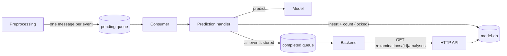

# ML Microservice

The service turns EEG feature rows into pain-rating analyses.

It consumes one message per detected event from RabbitMQ, runs a scikit-learn-compatible model on the features, stores the outcome in PostgreSQL and, once every event of an examination has been analysed, announces completion on a second queue. The backend can then read the results over HTTP.



## Contents

- [Input message](#input-message)
- [How an event is processed](#how-an-event-is-processed)
- [Completion event](#completion-event)
- [HTTP API](#http-api)
- [Models and confidence](#models-and-confidence)
- [Configuration](#configuration)
- [Database](#database)
- [Running](#running)
- [Testing](#testing)
- [Project layout](#project-layout)
- [Operational notes](#operational-notes)

## Input message

Messages are JSON objects on the pending queue.

| Field | Required | Meaning |
|---|---|---|
| `examination_id` | yes | UUID of the examination |
| `event_time_s` | yes | Finite number >= 0: seconds from the start of the recording. Must be unique within an examination, because it is the deduplication key |
| `total_analyses_count` | yes | Integer >= 1: how many events the examination has in total |
| `event_type` | no | Defaults to `predict_event`, the only registered type |
| everything else | no | Metadata is ignored (see `METADATA_KEYS` in `prediction_event_handler.py`). The remaining fields are passed to the model, which selects its own features by name and ignores the rest |

Messages carry many more columns than the model uses, so a new model can use other columns without code changes as long as preprocessing sends them.

## How an event is processed

The rule is that **every event that reaches the model step ends up as a stored row**. A rejected event would never be counted, and its examination would stay "processing" forever. Events that cannot produce a result are therefore stored as *invalid analyses*, and they count toward `total_analyses_count`.

| Situation | Outcome |
|---|---|
| Malformed JSON, non-object JSON, unknown `event_type` | Message rejected, not requeued |
| Missing or unparseable `examination_id`, `event_time_s` or `total_analyses_count`; negative or non-finite timestamp; total < 1 | Message rejected, not requeued |
| A model feature is infinite or non-numeric / a feature key is absent | Stored as invalid (`missing_features: ...` or `invalid_feature_values: ...`) |
| Model features are NaN or null | Stored as invalid (`null_features: ...`) unless the row's null share is within `MAX_MISSING_FEATURE_FRACTION`. |
| The model raises | Stored as invalid (`prediction_failed`) |
| The model output is unusable | Stored as invalid (`unusable_model_output`) |
| Result is outside `[0, 10]` or NaN | Stored as invalid (`result_out_of_range: <value>`) |
| Confidence is outside `[0, 1]` | Confidence stored as `NULL`; the analysis stays valid |
| The database rejects the row (`IntegrityError`, `DataError`) | Message rejected, not requeued |
| Database, broker or timeout failure | Wait 5 s, then requeue |
| Same `(examination_id, event_time_s)` again | First write wins; a conflicting duplicate is logged |

Details:

- The consumer processes one message at a time (`prefetch_count=1`).
- Writers for the same examination are serialised with a Postgres advisory lock (`pg_advisory_xact_lock`). Without it, the last two concurrent writers can each count only their own uncommitted row, and nobody publishes the completion event.
- Insertion is idempotent (`ON CONFLICT DO NOTHING`), so redelivered messages are safe.

## Completion event

After the transaction commits, if the number of stored rows has reached the stored `total_analyses_count`, the service publishes to the completed queue:

```json
{"event_type": "examination_completed", "examination_id": "8696f2c9-8115-4f76-bc31-5fd72cf656fb", "total_analyses_count": 12}
```

The message is persistent, and its `message_id` is the examination id. Delivery is **at-least-once**: a redelivered or late event can publish the event again, so receivers must be idempotent.

## HTTP API

| Endpoint | Purpose |
|---|---|
| `GET /examinations/{examination_id}/analyses` | Results of an examination |
| `GET /info` | App name and details of the loaded model |
| `GET /healthz` | Liveness probe |
| `GET /readyz` | Readiness probe: 503 with a `reason` (`model_not_loaded`, `consumer_not_running`, `database_unavailable`) |
| `GET /connections` | Diagnostics: `up` or `down` for the database, the RabbitMQ consumer and the RabbitMQ publisher. Always returns 200 and never includes error details |

### `GET /examinations/{examination_id}/analyses`

An examination is complete when the number of stored analyses reaches the expected total.

- **202**: not complete yet. Body: `{"status": "processing", "received": 2, "expected": 3}`. `expected` is `null` when nothing has arrived.
- **200**: complete.
- **422**: `examination_id` is not a UUID.
```json
{
  "examination_id": "8696f2c9-8115-4f76-bc31-5fd72cf656fb",
  "total_analyses_count": 2,
  "analyses": [
    {"analysis_id": 1, "time_stamp": 10500, "is_valid": true,  "result": 6.42, "confidence": 0.81, "invalid_reason": null},
    {"analysis_id": 2, "time_stamp": 12000, "is_valid": false, "result": null, "confidence": null, "invalid_reason": "missing_features: early_paf"}
  ]
}
```

- `time_stamp` is an **integer in milliseconds** from the start of the recording (`event_time_s * 1000`, rounded). The database keeps seconds as a float.
- `result` is rounded to 2 decimals. The database keeps the raw value.
- Analyses are ordered by time. `confidence` is optional (see below).

## Models and confidence

### Model artifacts

Artifacts live in `models/` and are stored with **Git LFS**. A checkout without LFS contains small pointer files, and the service refuses to start on one with a message telling you to run `git lfs pull`.

| File | Purpose |
|---|---|
| `lgbm_v3_2026-11-22.joblib` | The point model. A bare scikit-learn-compatible estimator, **fitted on a DataFrame** so it records `feature_names_in_` |
| `lgbm_v3_2026-11-22.json` | Optional sidecar with the same base name. Selected keys (version, target, `preproc_version`, `target_version`) are shown in `/info` |

`MODEL_PATH` selects the model. The feature list is **read from the model itself**, so there is no list to maintain in code. Startup fails if the file is missing, is an LFS pointer, has no `predict`, or records no feature names.

### Confidence

Confidence is optional everywhere: a missing value is `NULL`, never an error. The method depends on the model:

| Model | Confidence | Kind (`/info`) |
|---|---|---|
| Classifier (`predict_proba`) | Probability of the predicted class | `max_probability` |
| Regressor with CQR artifacts configured | Interval width ranked against validation intervals: 1 = narrower than nearly all of them | `interval_width_percentile` |
| Regressor, `interval.json` without `width_quantiles` | `1 - width / out_max` | `interval_width_scale` |
| Regressor without CQR | none | n/a |

The regressor scores are **relative rankings, not probabilities**. The interval also never changes the prediction: the model's output is stored unchanged, even if it falls outside its interval. If the confidence step fails at runtime, the analysis is stored without confidence, and the failure is logged.

When features had to be imputed, the score is multiplied by the share of features that were observed (1 minus imputed / total). The interval and the prediction are unchanged.

### CQR (conformalized quantile regression)

Set `CQR_BASE_PATH` to the shared prefix of a CQR export, without the suffix:

```
cqr_lgbm_a20_v3_2026-11-22_lo.joblib        lower-quantile model
cqr_lgbm_a20_v3_2026-11-22_hi.joblib        upper-quantile model
cqr_lgbm_a20_v3_2026-11-22_interval.json    qhat, alpha, out_max, optional width_quantiles
```

Unset `CQR_BASE_PATH` to switch confidence off for a regressor. At startup the service checks that both quantile models were trained on the same features, in the same order, as the point model, and that `preproc_version` and `target_version` agree wherever both sides define them. A mismatch stops the service from starting, so retrain the models together.

### Changing the model

1. Put the new `.joblib` (and its `.json`, and the CQR files if used) into `models/`.
2. Point `MODEL_PATH` and `CQR_BASE_PATH` at them.
3. Make sure every feature the model uses is sent by preprocessing. The shipped-model tests check this in CI.

## Configuration

Settings come from environment variables or a `.env` file (`core/config.py`).

| Variable | Default | Notes |
|---|---|---|
| `MODEL_DB_URL` | none, **required** | Must start with `postgresql+asyncpg://` |
| `RABBITMQ_HOST` / `RABBITMQ_PORT` | `localhost` / `5672` | |
| `RABBITMQ_USER` / `RABBITMQ_PASSWORD` | `guest` / `guest` | Percent-encoded when the URL is built |
| `QUEUE_URL` or `RABBITMQ_URL` | none | Full AMQP URL; overrides the four variables above |
| `PENDING_ANALYSIS_QUEUE_NAME` or `RABBITMQ_PENDING_ANALYSIS_QUEUE` | `ml_microservice_pending_queue` | Queue to consume. Must not be empty |
| `COMPLETED_ANALYSIS_QUEUE_NAME` or `RABBITMQ_COMPLETED_ANALYSIS_QUEUE` | `ml_microservice_completed_queue` | Queue to publish to. Must not be empty or equal the pending queue |
| `MODEL_PATH` | none | The point model |
| `CQR_BASE_PATH` | none | Optional; blank means disabled |
| `MAX_MISSING_FEATURE_FRACTION` | 1.0 | Fraction between 0.0 and 1.0. Represents the highest percentage of features received that are allowed to be null for that can be accepted for prediction. |

When both names of a queue variable are set, the first one listed wins.

## Database

Table `analyses` (schema in `database/model/`, mounted into the `model-db` container):

| Column | Type | Notes |
|---|---|---|
| `analysis_id` | `BIGINT` identity | Primary key |
| `examination_id` | `UUID` | Unique together with `event_timestamp` |
| `event_timestamp` | `DOUBLE PRECISION` | Seconds from the start of the recording (`event_time_s`), `>= 0` |
| `result` | `DOUBLE PRECISION` | `NULL` for invalid analyses; otherwise within `[0, 10]` |
| `confidence` | `DOUBLE PRECISION` | Optional, within `[0, 1]` |
| `total_analyses_count` | `INTEGER` | `>= 1` |
| `is_valid` | `BOOLEAN` | |
| `invalid_reason` | `TEXT` | Set exactly when `is_valid` is false |

A `CHECK` constraint keeps validity, result and reason consistent. The scripts in `docker-entrypoint-initdb.d` run **only on an empty volume**, so schema changes need a manual migration or `docker compose down -v` in development.

## Running

### Docker Compose

From the repository root (a `.env` file with the `RABBITMQ_*` and queue variables is required):

```bash
docker compose up --build ml
```

This also starts `rabbitmq` and `model-db`, which the service depends on.

## Testing

```bash
pytest                          # everything
pytest -m "not integration"     # fast unit tests, no Docker needed
pytest -m integration           # needs Docker
```

| Location | What it covers |
|---|---|
| `tests/api/` | Routes through the real FastAPI stack, lifespan, probes, `/connections` |
| `tests/core/` | Settings, including a contract test against `docker-compose.yml` |
| `tests/domain/` | Entity invariants |
| `tests/infrastructure/` | Handler, consumer, publisher, repository, predictor, confidence (mocked I/O) |
| `tests/integration/` | Real Postgres and RabbitMQ via testcontainers: repository SQL, the advisory lock under concurrency, and a full queue -> database -> completion-event round trip |

Notes:

- Integration tests start throwaway containers, so Docker must be running.
- `tests/conftest.py` sets a default `MODEL_DB_URL`, because `Settings()` is created at import time.

## Project layout

```
src/
  api/              FastAPI app, routes, schemas, dependencies
  core/             configuration, logging
  domain/           entities and interfaces (repository, predictor, publisher)
  infrastructure/
    db/             SQLAlchemy models and session factories
    event_handlers/ prediction event handler
    messaging/      RabbitMQ consumer and publisher
    repositories/   SQLAlchemy analysis repository
    services/       sklearn predictor, confidence estimators, analysis service
models/             model artifacts (Git LFS)
tests/
```

Dependencies point inward: `domain` imports nothing from the other layers, and the handler receives its predictor, session factory, publisher and repository factory by injection.

## Operationa notes

## Operational notes
 
- **Rejected messages are dropped.** There is no dead-letter exchange, so a permanently rejected message is gone after the error is logged. Add a DLX to the pending queue if you need to inspect or replay them. Every service that declares that queue must use the same arguments.
- **Transient failures retry without a limit**, with a 5 s pause, and they block the queue while they last.
- **Queue declarations must match across services.** All of them declare the queues as `durable=True` without extra arguments. A mismatch makes RabbitMQ close the channel with `PRECONDITION_FAILED`.
- **An examination cannot be re-analysed under the same id.** The first stored row for each `(examination_id, event_time_s)` wins, and later duplicates are ignored, with a warning if they conflict. Re-running needs a new examination id.
- **Watch the share of invalid analyses.** A broken model or an upstream change shows up as a surge of invalid rows, not as errors. The `ERROR` and `WARNING` logs from the handler are the signal.
- **Do not expose `/info` or `/connections` publicly without thinking it through.** They are unauthenticated, like the health probes.